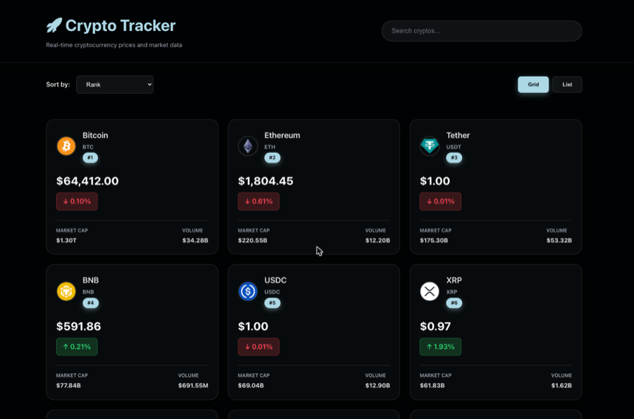
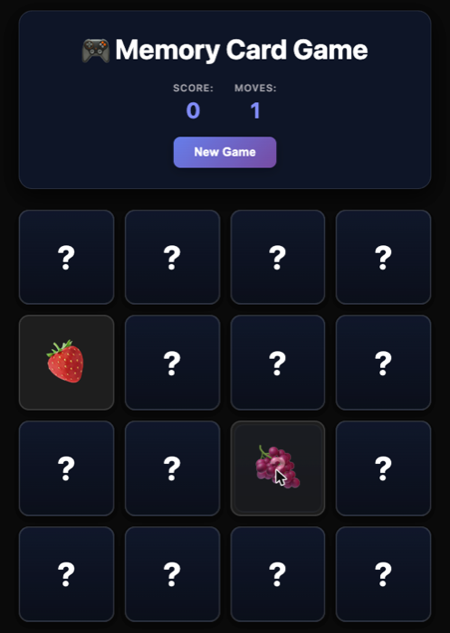

<!-- Header banner -->

  

  

---

## Hi there, I'm Andrevis 

I'm a **Full Stack Developer** focused on **React**, building responsive, user-focused web applications.

- 🔭 Currently working as a **Senior Asset Management Systems Analyst** at **Thermo Fisher Scientific**, building automation and reporting tools with Power Automate, Power Apps and Power BI
- ⚛️ Building web apps with **React, JavaScript, Node.js and SQL**
- 🌱 Leveling up my **backend and full stack** skills
- 🎯 Looking for **Frontend (React)** or **Full Stack** roles in Costa Rica or remote
- 🌐 Portfolio: **[andrevis.dev](https://andrevis.dev)**

 

## 🛠️ Tech Stack

  <b>Frontend</b>  
  

  <b>Backend & Databases</b>  
  

  <b>Tools</b>  
  

## 🚀 Featured Projects

<table>
  <tr>
    <td width="50%" valign="top">
      
      <h3>🪙 Crypto Tracker</h3>
      
Live market data for the top 100 cryptocurrencies, with search, 6 sort modes, grid/list views and a detail page with a 7-day price chart.

      
<code>React</code> <code>React Router</code> <code>Recharts</code> <code>REST API</code>

      

        <a href="https://crypto-project-rosy-theta.vercel.app/"><b>🔗 Live demo</b></a> ·
        <a href="https://github.com/Heiyey/Crypto-Project"><b>💻 Code</b></a>
      

    </td>
    <td width="50%" valign="top">
      
      <h3>🎮 Memory Game</h3>
      
Card-matching game with Fisher–Yates shuffling, score and move counters, and all game logic in a custom React hook.

      
<code>React</code> <code>Custom Hooks</code> <code>Vite</code> <code>CSS</code>

      

        <a href="https://memory-game-sand-omega.vercel.app/"><b>🔗 Live demo</b></a> ·
        <a href="https://github.com/Heiyey/Memory-Game"><b>💻 Code</b></a>
      

    </td>
  </tr>
</table>

## 📫 Let's Connect

  &nbsp;&nbsp;
  &nbsp;&nbsp;
  

<!-- Footer banner -->

  

